# Doctor Tracker

**Next.js 16 · React 19 · TanStack Query 5 · Tailwind CSS 4 · Recharts 3 · Express 5 · Mongoose 9 · MongoDB 7 · Zod 4 · TypeScript**

## Description

Doctor Tracker is a secure administrative web application for managing doctors and the patients under their care. Signed-in staff can register doctors, add patients under a doctor, edit and remove patient records, and find anyone quickly with search, filters, sorting and pagination. A dashboard charts patients per doctor, admissions over the last 7, 30 or 90 days, and patients by condition.

The project is two separate services: a **Next.js frontend** and a **standalone Express REST API** over MongoDB. The focus is on index-backed queries, a plain and predictable admin UI, and clear data visualization.

## Links

| | |
|---|---|
| Live app | https://doctor-tracker-psi.vercel.app |
| Live API | https://doctor-tracker-api-indol.vercel.app/health (REST base path `/api/v1`) |
| Frontend code | https://github.com/cenedyportfolio-byte/doctor-tracker/tree/main/frontend |
| Backend code | https://github.com/cenedyportfolio-byte/doctor-tracker/tree/main/backend |

**Demo accounts** (created by `npm run seed`):

| Role | Email | Password | Can do |
|---|---|---|---|
| Admin | `admin@doctortracker.dev` | `Admin@12345` | Everything |
| Viewer | `viewer@doctortracker.dev` | `Viewer@12345` | Read only. Write controls are hidden and the API answers writes with 403. |

The sign-in page has Admin and Viewer buttons that fill these in.

### Contents

- [Links](#links)
- [Features](#features)
- [Setup Guide](#setup-guide)
- [System Architecture](#system-architecture)
- [Technical Decisions](#technical-decisions)
- [Database Indexes and Query Plans](#database-indexes-and-query-plans)
- [Visual Evidence](#visual-evidence)
- [Testing](#testing)
- [Scalability Considerations](#scalability-considerations)
- [Project Structure](#project-structure)

---

## Features

| Requirement | Implementation |
|---|---|
| **Authentication** | Email and password (bcrypt, cost 12). The session is a signed JWT in an **httpOnly, SameSite=Lax** cookie (Secure in production) that expires after 8 hours. Failed logins are rate-limited (10 per 15 minutes per IP and email). Unknown emails take as long as wrong passwords, so response time doesn't reveal which accounts exist. |
| **Route protection** | `src/proxy.ts` (Next 16's replacement for middleware) verifies the JWT before any app page renders and redirects to `/login?next=…`. Only `/` and `/login` are public. The API independently requires a valid session on every route except `/auth/*`, and reloads the user on each request. |
| **Authorization** | Two roles, `admin` and `viewer`. One router-level guard (`requireAdminForWrites`) makes every non-GET request under `/api/v1` admin-only, so a new route cannot forget the check. The UI hides write actions from viewers. |
| **Doctors** | Create, edit and delete (name, specialization, hospital, phone, email). The list has **prefix search** (name, email, hospital, specialization, phone), **filters** (specialization, hospital, joined-date range), **sorting** (newest, oldest, name A–Z / Z–A) and **pagination** (10, 20 or 50 per page). |
| **A doctor's patients** | The doctor page shows contact details, the patient mix by condition, and that doctor's own searchable, filterable, paginated patient list. **Add a patient under the doctor** with `POST /doctors/:id/patients`. **Remove a patient from the doctor's list** with `DELETE /doctors/:id/patients/:patientId`, which only succeeds if the patient belongs to that doctor. A doctor who still has patients can't be deleted; the UI says so before you try. |
| **Patients** | List, create, **edit** (including reassigning the doctor) and delete. **Search** by name, diagnosis, phone or email. **Filters**: condition, doctor, gender, age range and admission-date range. **Sorting** and **pagination**. Tapping a row opens a read-only details panel with Edit and Delete for admins. |
| **Dashboard** | Four stat tiles: doctors, patients, critical patients, and admissions in the selected period compared with the previous period. Three charts: **patients per doctor** (top 10), **patients over time** (admissions per day, with a 7D / 30D / 90D toggle) and **patients by condition**. Bars link to the doctor or to the filtered patient list, and every chart can switch to a table view. |
| **UI** | A public landing page and a split-screen sign-in page share the brand: a dark teal panel, the logo and a product preview. Inside the app, a fixed sidebar (Dashboard, Doctors, Patients) and a slim top bar with the user and Log out. On phones the sidebar becomes a drawer. Lists put the toolbar (search, filters, sort, primary action) above the table and pagination below; phones show fewer columns. Create and edit open in dialogs, deletes ask for confirmation, and results show as toasts. Every list and chart has a loading skeleton, an empty state and an error state with retry. |
| **Validation and errors** | Zod on both sides. The API rejects unknown fields (no mass assignment), invalid ids (400), duplicates (409) and malformed JSON, all in one error format that the forms map back onto fields. |

---

## Setup Guide

### Prerequisites

- **Node.js 20.19+** (developed on Node 22–26) and npm 10+
- **MongoDB 6+**. The simplest route is Docker (`docker compose up -d mongo` starts `mongo:7.0`). A MongoDB Atlas URI also works.

> On Linux kernels 6.19 and newer, recent native `mongod` 8.0 builds refuse to start ([SERVER-121912](https://jira.mongodb.org/browse/SERVER-121912)). The Docker image (MongoDB 7.0) is not affected.

### Option A: run locally

```bash
# 1. Database
cp .env.example .env              # docker compose only: ports and the shared secret
docker compose up -d mongo        # MongoDB on localhost:27017 (change MONGO_PORT in .env if it's taken)

# 2. API → http://localhost:4000
cd backend
cp .env.example .env              # set JWT_SECRET (openssl rand -base64 48), and MONGODB_URI if needed
npm install
npm run seed                      # 2 demo users, 48 doctors, 1,800 patients (deterministic)
npm run dev

# 3. Web app → http://localhost:3000
cd ../frontend
cp .env.example .env.local        # set JWT_SECRET to the SAME value as backend/.env
npm install
npm run dev
```

Open http://localhost:3000, choose **Sign in**, and use a demo account.

### Option B: everything in Docker

```bash
cp .env.example .env              # set JWT_SECRET (any random string of 32+ characters)
docker compose --profile app up -d --build
docker compose --profile app run --rm api node dist/scripts/seed.js --force   # demo data
```

The web app runs on `http://localhost:${WEB_PORT}` (default 3000) and the API on `http://localhost:${API_PORT}` (default 4000). To use Atlas instead of the bundled container, set `MONGODB_URI` in the root `.env`, including the `/doctor_tracker` database name.

### Option C: Vercel

The app deploys as two Vercel projects:

- **`frontend/`** is a standard Next.js project.
- **`backend/`** uses Vercel's zero-config Express support. `backend/server.js` imports the compiled app from `dist/` and opens one MongoDB connection per instance. `backend/vercel.json` sets `framework: "express"`.

Set these environment variables:

- **API:** `MONGODB_URI` and `JWT_SECRET`. Vercel sets `NODE_ENV=production`, which makes the cookie Secure.
- **Web app:** `API_URL` (the API's URL) and the same `JWT_SECRET`.

Because the web app proxies `/api/*`, the session cookie stays first-party and no CORS setup is needed.

### Environment variables

Each part has its own example file: [`backend/.env.example`](backend/.env.example), [`frontend/.env.example`](frontend/.env.example), and the root [`.env.example`](.env.example) for Docker Compose. Real `.env` files are git-ignored.

| Variable | Where | Purpose |
|---|---|---|
| `MONGODB_URI` | backend (optional in root `.env` for Docker) | MongoDB connection string, local or Atlas (`mongodb+srv://…/doctor_tracker`) |
| `JWT_SECRET` | backend **and** frontend | Signs session tokens (API) and verifies them (web proxy). Must be identical in both and at least 32 characters. Server-side only. |
| `JWT_EXPIRES_IN` | backend | Session lifetime (default `8h`) |
| `COOKIE_NAME` / `SESSION_COOKIE_NAME` | backend / frontend | Session cookie name (default `dt_session`) |
| `COOKIE_SECURE` | backend | `true` by default in production; set `false` only for plain-HTTP setups |
| `CORS_ORIGINS` | backend | Origins allowed to call the API directly. Not needed when traffic goes through the web app. |
| `TRUST_PROXY` | backend | Express `trust proxy`, so rate limiting sees real client IPs |
| `STATS_CACHE_TTL_SECONDS` | backend | Dashboard cache TTL (default 60; `0` disables it) |
| `API_URL` | frontend | Where `/api/*` is proxied (default `http://localhost:4000`). Read at build time. |

### Scripts

| Command | Where | What it does |
|---|---|---|
| `npm run dev` | backend, frontend | Development servers |
| `npm run build && npm start` | backend, frontend | Production build and start |
| `npm run seed` | backend | Resets the database to the demo dataset. Refuses to run in production without `--force`. |
| `npm run db:sync-indexes` | backend | Makes the database's indexes match the schemas: builds missing ones and drops obsolete ones. Run it after deploying index changes (`db:sync-indexes:prod` uses the compiled build). |
| `npm run explain` | backend | Prints the query plan of every hot query (see [Database Indexes and Query Plans](#database-indexes-and-query-plans)) |
| `npm test` | backend | Vitest and Supertest integration tests against a real MongoDB |
| `npm run typecheck` | backend, frontend | TypeScript checks |
| `npm run lint` | frontend | ESLint |

---

## System Architecture

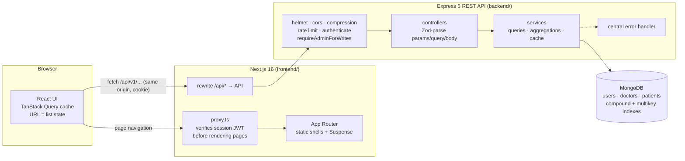

**Two independent services that talk REST.** The browser only talks to the Next.js origin. Next.js serves the pages and proxies `/api/*` to Express. The API owns all data access and business rules; the web app never touches MongoDB.

**How a request flows**

1. **Page navigation** (`/patients?condition=critical`): `proxy.ts` reads the `dt_session` cookie and verifies the JWT's signature, issuer, audience and expiry with `jose`. Without a valid session it redirects to `/login?next=…`. Otherwise Next.js serves the page's prerendered shell and the client components stream in.
2. **Data** (`GET /api/v1/patients?condition=critical&page=1`): TanStack Query calls the same-origin URL and the rewrite forwards it, cookie included, to Express. `authenticate` verifies the token and reloads the user, so a deactivated account loses access immediately. The controller validates the query with Zod and the service runs an index-backed query that returns `{ data, meta }`.
3. **Writes** (`POST /api/v1/doctors/:id/patients`): `requireAdminForWrites` checks the role, Zod validates the body (unknown keys rejected), then the service runs. On success the server clears its dashboard cache, and the client invalidates exactly the query keys the write affects.
4. **Errors** always have the shape `{ error: { code, message, details[] } }`. Forms map `details` onto fields and everything else becomes a toast. A `401` on any data call means the session expired, so the app sends the user to login with an "expired" notice.

### Authentication flow

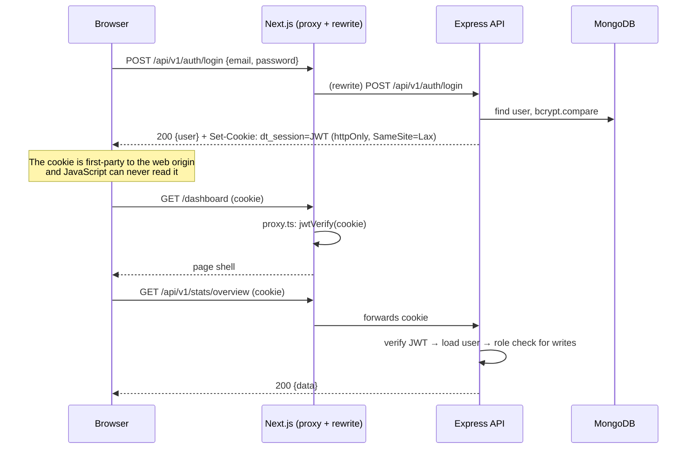

### API reference (`/api/v1`)

Every route except `/auth/*` needs a session. Every non-GET route below `/auth` also needs the `admin` role.

| Method | Path | Description |
|---|---|---|
| `POST` | `/auth/login` | Sign in and set the session cookie (rate-limited) |
| `POST` | `/auth/logout` | Clear the session cookie |
| `GET` | `/auth/me` | Current user |
| `GET` / `POST` | `/doctors` | List (`?search&specialization=a,b&hospital&from&to&sort&page&limit`) / create |
| `GET` | `/doctors/facets` | Specializations and distinct hospitals (filter options) |
| `GET` | `/doctors/options` | Lightweight searchable list for the doctor picker (`?search&limit`) |
| `GET` / `PATCH` / `DELETE` | `/doctors/:id` | Read with patient counts by condition / update / delete (409 if the doctor still has patients) |
| `GET` / `POST` | `/doctors/:id/patients` | That doctor's patients (same query params as `/patients`) / add a patient under the doctor |
| `DELETE` | `/doctors/:id/patients/:patientId` | Remove a patient from the doctor's list (404 if the patient isn't theirs) |
| `GET` / `POST` | `/patients` | List (`?search&condition=a,b&doctor&gender&minAge&maxAge&from&to&sort&page&limit`) / create |
| `GET` / `PATCH` / `DELETE` | `/patients/:id` | Read / update (including reassigning the doctor) / delete |
| `GET` | `/stats/overview` | Whole dashboard in one call (`?range=7d|30d|90d`, default `30d`) |
| `GET` | `/health` | Liveness and database connectivity (outside `/api/v1`) |

List responses have the shape `{ data: T[], meta: { page, limit, total, totalPages, hasNextPage, hasPrevPage } }`.

---

## Technical Decisions

### 1. Server state in TanStack Query and list state in the URL, instead of Redux or a Context store

**The problem.** The app has three kinds of state, and treating them as one is what usually makes admin apps sluggish and buggy:

| Kind | Examples | Where it lives |
|---|---|---|
| Server cache | doctors, patients, dashboard stats, the session | **TanStack Query** |
| Shareable view state | page, page size, search, filters, sort | **The URL query string** |
| Ephemeral UI state | which dialog is open, a filter draft | **Local `useState`** |

**Why not Redux or a Context store?** Almost all of the "global state" here is a copy of server data. With Redux we would hand-write loading and error flags, request de-duplication, a cache per filter combination, cancellation, retries and invalidation after writes. TanStack Query does all of that correctly by default. Keeping filters in a store would also make them worse: lost on reload, not shareable, and invisible to the back button. And a Context-based store re-renders every consumer on every change.

**How it works here**

- **Hierarchical query keys** ([`lib/query-keys.ts`](frontend/src/lib/query-keys.ts)), for example `['patients','list',{…params, scope}]`. Each write invalidates exactly what it affects. Adding a patient invalidates patient lists, doctor lists (their patient counts), doctor profiles (their patient mix) and the dashboard, but not the filter options or the session.
- **Paging without flashes.** `placeholderData: keepPreviousData` keeps the current rows on screen, dimmed under a thin progress bar, while the next page loads. The **next page is prefetched** as soon as the current one arrives, and **hovering a doctor row prefetches the profile**.
- **The URL is the source of truth** ([`hooks/use-url-state.ts`](frontend/src/hooks/use-url-state.ts)). List views read typed params from `useSearchParams()`, validated against allow-lists so a hand-edited URL can't send garbage. Updates go through `window.history.replaceState`, which Next.js syncs back **without a server round trip** and without a history entry per keystroke. As a result every view is linkable: the "Critical patients" tile and the condition bars open `/patients?condition=critical`, and the per-doctor bars open that doctor's page.
- **Search** keeps keystrokes local and writes the URL only after 300 ms without typing, so there is one request per pause, not per character. Filter drafts live in the filter panel and apply together with "Show results".
- **Retries that make sense.** Queries retry network errors and 5xx responses, but never 4xx (a validation error won't fix itself). A `401` triggers one full redirect to login, which also drops every cached query from the dead session.

**Trade-offs.** URL params must be parsed and validated on every read, which a few small helpers handle. Nothing persists offline. If client-only state ever has to span pages (a multi-step wizard, say), a small store like Zustand would be the next step; Redux would still be more than this app needs.

### 2. Index-backed prefix search with keyword arrays, instead of `$regex` scans, `$text` or Atlas Search

**The problem.** Admins type fragments such as `"joh smi"`, `"riverside"`, `"555-01"` or `"diab"`. Search has to match partial words across several fields, combine with filters, sorting and pagination, and stay fast as the collections grow.

| Option | Partial words | Uses an index | Verdict |
|---|---|---|---|
| `{ name: /joh/i }` (unanchored, case-insensitive `$regex`) | ✅ | ❌ full scan, O(n) | Fine at 1k documents, collapses at 1M |
| `$text` index | ❌ whole words and stems only (`joh` ≠ `john`) | ✅ | Wrong for type-ahead; one text index per collection; hard to combine with custom sorts |
| Atlas Search (`autocomplete`) | ✅ (plus fuzzy matching) | ✅ (Lucene) | Best at scale, but needs Atlas; not available on self-hosted MongoDB |
| **Keyword array + anchored prefix regex** | ✅ prefixes | ✅ multikey index bounds | **Chosen** |

**How it works** ([`lib/search.ts`](backend/src/lib/search.ts)):

1. A `pre('validate')` hook stores a hidden `searchKeywords` array on every doctor and patient. It holds lower-cased, accent-stripped tokens from the searchable fields, plus the full email and the digits of the phone number. *José Álvarez · Cardiology* becomes `["jose","alvarez","cardiology", …]`.
2. A query like `"Jo smi"` becomes `{ searchKeywords: { $all: [/^jo/, /^smi/] } }`. Anchored, case-sensitive regexes on an already lower-cased field compile to tight index bounds (`["jo","jp")`), so MongoDB walks a few index keys instead of scanning documents. Input is regex-escaped and capped at 5 terms of 40 characters. Terms shorter than 2 characters are ignored: a single letter matches most of the collection, and the planner would otherwise walk thousands of keys.
3. Because the result is a plain filter, it composes with every other filter, sort and page.

**Trade-offs.** Writes do a little more work, since each document stores a keyword array and its index entries. Matching is prefix-only (`ohn` won't find `John`), with no typo tolerance and no relevance ranking: results follow the chosen sort. Those are reasonable defaults for an admin directory. At larger scale the drop-in upgrade is Atlas Search's `autocomplete` operator, which would replace only `buildSearchFilter`.

### Other decisions in brief

- **Same-origin API through Next.js rewrites.** The browser never calls the API's origin directly, so the httpOnly cookie is first-party, CORS never comes into play, and the token is never visible to JavaScript (unlike tokens in `localStorage`, which any XSS can read). `proxy.ts` verifies the same JWT so protected pages never flash for signed-out users, but the API still enforces auth itself: the proxy is a UX layer, not the only defense.
- **One admin guard at the router.** `requireAdminForWrites` is mounted once, right after `authenticate`, instead of an `authorize('admin')` call on each write route. A test sends every write route a viewer session and expects 403.
- **One dashboard endpoint.** `/stats/overview` runs its queries in parallel and returns everything the page needs. The aggregations are shaped to be answered from indexes alone (next section). `$lookup` runs after `$limit`, so only 10 doctors are joined. The result is cached in-process for 60 seconds; concurrent requests share one in-flight computation, and every write through the API clears the cache.
- **Accurate patient counts.** Instead of a denormalized `patientCount` that can drift, the doctors list counts patients only for the doctors on the current page, with one covered `$group` on the `{doctor, …}` index.
- **Accessible primitives without a UI library.** The native `<dialog>` element (modal, side panel and drawer variants) gives a browser-managed focus trap, an inert background and Escape to close. The doctor picker follows the WAI-ARIA combobox pattern, focus rings are visible, conditions always show a text label next to the colored dot, and every chart has a table view. An axe-core audit at 390, 768, 1024, 1280 and 1440 px reports no violations.
- **Branded entry, plain workspace.** The landing and sign-in pages carry the brand: a dark teal panel with soft glows, a faint ECG trace, the heart-pulse logo, and real screenshots of the app (no stock or generated imagery). Medical line icons appear where they carry meaning: one per specialty, on the dashboard tiles and in empty states. The screens people work in stay deliberately plain: one font, neutral greys, 1 px borders, and one accent color used only for primary buttons and the active nav item. Status colors encode patient condition and nothing else, always next to a text label or legend. There's a single light theme, so every screen is tested in the one theme users actually get.
- **Next.js 16 Cache Components.** The app shells are prerendered at build time. Request-dependent pieces (`useSearchParams`, `usePathname` on dynamic routes) sit inside Suspense boundaries. Session-dependent UI renders only after hydration, which avoids server/client mismatches.

---

## Database Indexes and Query Plans

Compound indexes follow **filter → sort → `_id`**. Every list sorts with an `_id` tie-breaker, so pagination is stable and the index supplies the full order without an in-memory sort.

| Collection | Index | Queries it serves |
|---|---|---|
| `users` | `{ email: 1 }` unique | Login lookup; one account per email |
| `doctors` | `{ email: 1 }` unique | Duplicate-email check on create and update (409) |
| `doctors` | `{ createdAt: -1, _id: -1 }` | Doctors list sorted newest or oldest; joined-date range filter; dashboard "doctors joined this period vs last period" (two `COUNT_SCAN`s) |
| `doctors` | `{ specialization: 1, createdAt: -1, _id: -1 }` | Specialization filter (with the date range), sorted by joined date |
| `doctors` | `{ hospital: 1, createdAt: -1, _id: -1 }` | Hospital filter; distinct hospitals for the filter options (`DISTINCT_SCAN`) |
| `doctors` | `{ name: 1, _id: 1 }` | Name A–Z / Z–A sort; the doctor picker (`/doctors/options`) |
| `doctors` | `{ searchKeywords: 1 }` (multikey) | Prefix search |
| `patients` | `{ doctor: 1, admissionDate: -1, _id: -1 }` | A doctor's patient list; the doctor filter on the patients page; patient counts for one page of doctors (covered); dashboard patients per doctor (covered); a doctor's patient mix; the "doctor still has patients" check |
| `patients` | `{ admissionDate: -1, _id: -1, condition: 1 }` | Patients list sorted newest or oldest; admission-date range filter; dashboard admissions per day (covered, because `condition` in the index lets it count critical admissions without reading documents) |
| `patients` | `{ condition: 1, admissionDate: -1, _id: -1 }` | Condition filter (with the date range); filtered totals (`COUNT_SCAN`); dashboard patients by condition (covered) |
| `patients` | `{ name: 1, _id: 1 }` | Name A–Z / Z–A sort |
| `patients` | `{ searchKeywords: 1 }` (multikey) | Prefix search |

Other habits: `find` and `countDocuments` run in parallel, and unfiltered totals use `estimatedDocumentCount()` (collection metadata, no scan). Reads use `.lean()` and explicit projections. `populate` loads only the doctors on the current page.

### Before and after

The table below comes from `npm run explain`, which drives the real query builders. Data: local MongoDB 7.0 with the seeded dataset (48 doctors, 1,800 patients). At this size every query takes 0–8 ms, so documents examined is the number that matters.

| Query | Before | After |
|---|---|---|
| Dashboard: patient breakdowns | `COLLSCAN`, **1,800 docs read** (one `$facet` over the whole collection) | Two covered index scans (`condition…`, `doctor…`), **0 docs read** |
| Dashboard: doctor breakdowns | `COLLSCAN`, 48 docs read | Collection metadata plus two `COUNT_SCAN`s, **0 docs read** |
| Dashboard: admissions trend | `IXSCAN`, 1,756 docs read (12-month range) | Covered `IXSCAN`, **0 docs read** (90-day range, 501 index keys) |
| Patients: search `"a"` + condition, date, gender, age | 258 keys, 258 docs → 9 results | 65 keys, 41 docs → 10 results (one-letter terms are ignored) |

The trend row isn't like-for-like: the 12-month range was dropped along with the 6M/12M toggle. The point is that the remaining ranges no longer read documents at all. The search row returns 10 results instead of 9 because the one-letter term no longer filters.

<details>
<summary>Full <code>npm run explain</code> output (after)</summary>

| Query | Plan | Keys examined | Docs examined | Returned | ms |
|---|---|---|---|---|---|
| Doctors: default list, page 1 | IXSCAN(createdAt_-1__id_-1) | 10 | 10 | 10 | 0 |
| Doctors: default list, page 3 | IXSCAN(createdAt_-1__id_-1) | 30 | 10 | 10 | 0 |
| Doctors: search "car" + specialization + joined date | IXSCAN(searchKeywords_1) | 5 | 4 | 3 | 0 |
| Doctors: hospital filter, sorted by name | IXSCAN(hospital_1_createdAt_-1__id_-1) | 4 | 4 | 4 | 0 |
| Doctors: patient counts for one page | IXSCAN(doctor_1_admissionDate_-1__id_-1) (index only) | 93 | 0 | 84 → 8 | 0 |
| Patients: default list, page 1 | IXSCAN(admissionDate_-1__id_-1_condition_1) | 10 | 10 | 10 | 0 |
| Patients: search "a" + condition + date + gender + age | IXSCAN(admissionDate_-1__id_-1_condition_1) | 65 | 41 | 10 | 0 |
| Patients: search "ar" + condition + date + gender + age | IXSCAN(searchKeywords_1) | 68 | 47 | 2 | 0 |
| Patients: condition + admission date | IXSCAN(condition_1_admissionDate_-1__id_-1) | 10 | 10 | 10 | 0 |
| Patients: gender + age only | IXSCAN(admissionDate_-1__id_-1_condition_1) | 70 | 70 | 10 | 0 |
| Patients: count for condition + date | COUNT_SCAN(condition_1_admissionDate_-1__id_-1) (index only) | 22 | 0 | 21 → 1 | 0 |
| Patients: one doctor's list | IXSCAN(doctor_1_admissionDate_-1__id_-1) | 10 | 10 | 10 | 0 |
| Dashboard: admissions trend (90d) | IXSCAN(admissionDate_-1__id_-1_condition_1) (index only) | 501 | 0 | 501 → 1 | 5 |
| Dashboard: patients per condition | IXSCAN(condition_1_admissionDate_-1__id_-1) (index only) | 1800 | 0 | 1800 → 5 | 7 |
| Dashboard: patients per doctor (top 10) | IXSCAN(doctor_1_admissionDate_-1__id_-1) (index only) | 1800 | 0 | 1800 → 10 | 8 |
| Dashboard: doctors joined (current period) | COUNT_SCAN(createdAt_-1__id_-1) (index only) | 5 | 0 | 4 → 1 | 0 |
| Dashboard: doctors joined (previous period) | COUNT_SCAN(createdAt_-1__id_-1) (index only) | 3 | 0 | 2 → 1 | 0 |
| Doctor profile: patient mix | IXSCAN(doctor_1_admissionDate_-1__id_-1) | 29 | 29 | 29 → 1 | 1 |

</details>

---

## Visual Evidence

Screenshots come from the production build (`next build && next start`) with the seeded demo data, signed in as the admin. Desktop is 1440 px wide; mobile is 390 px.

### Desktop

**Dashboard**
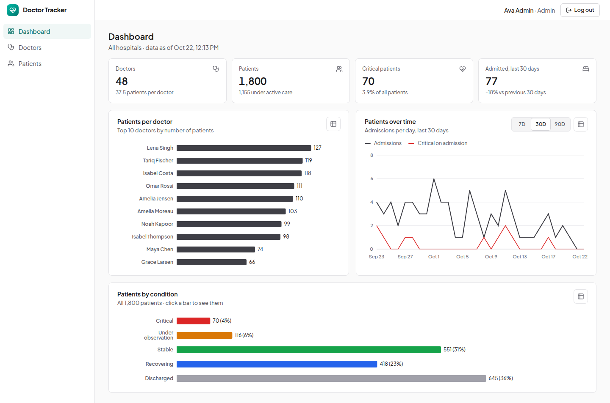

**Doctors: search, filters, sort and pagination**
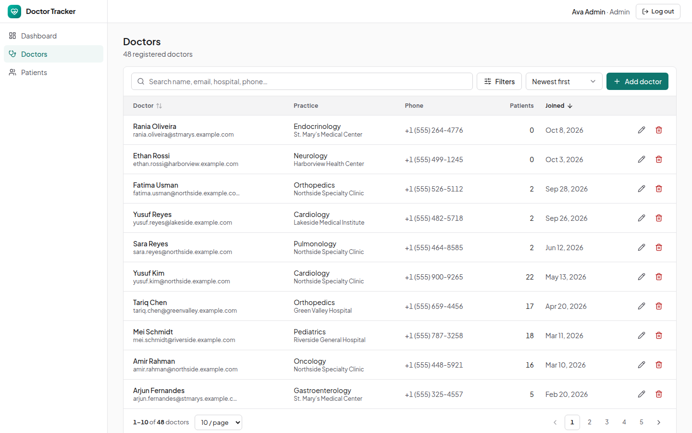

**A doctor's page with their patients**
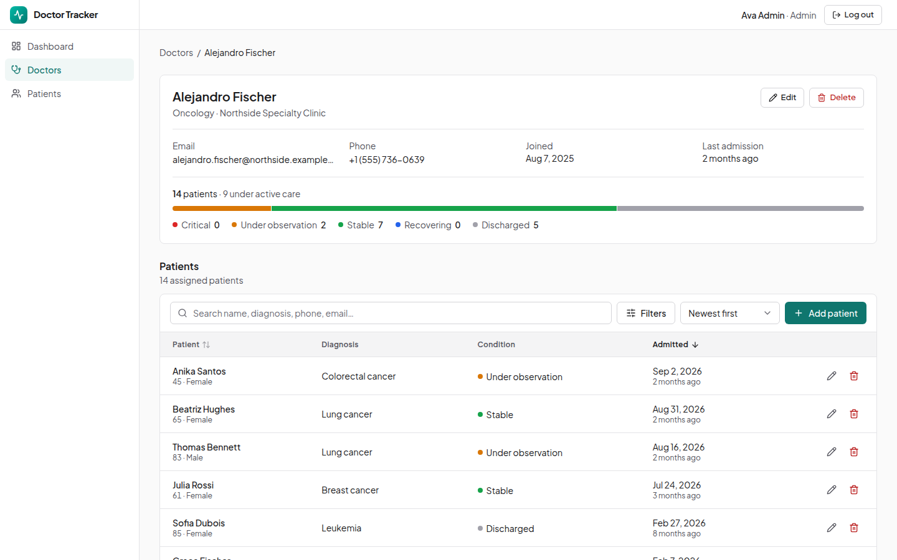

| Add a patient under a doctor | Patient filters |
|---|---|
| 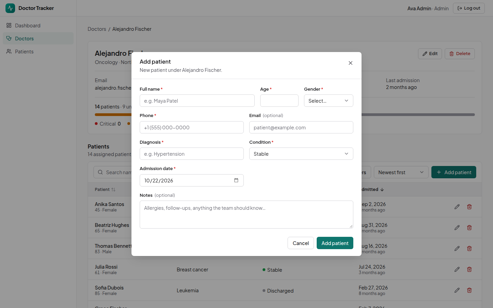 | 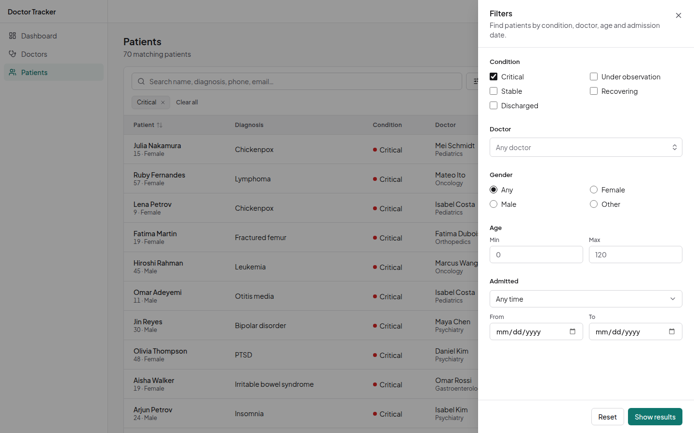 |

| Landing page | Sign in |
|---|---|
| 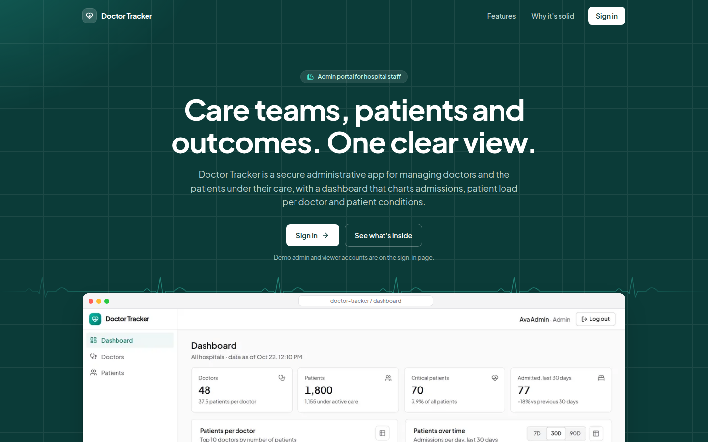 | 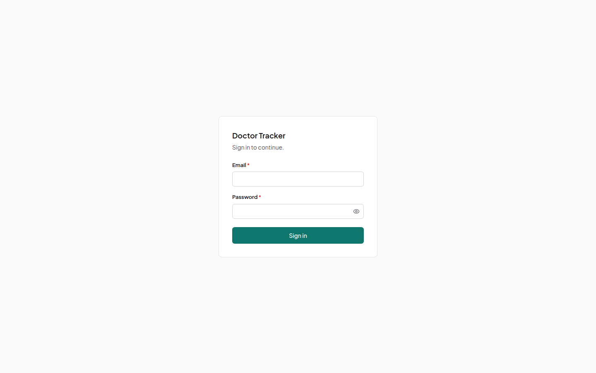 |

### Mobile

| Dashboard | Navigation drawer | Doctors |
|---|---|---|
| 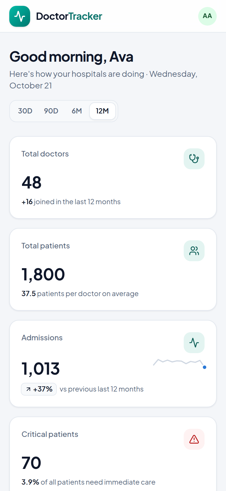 | 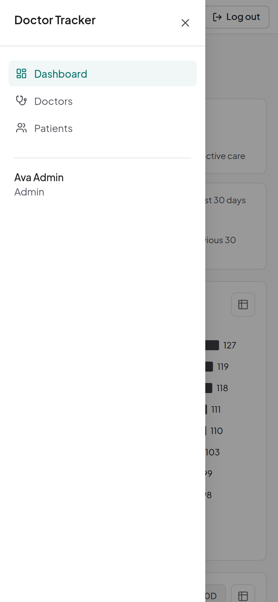 | 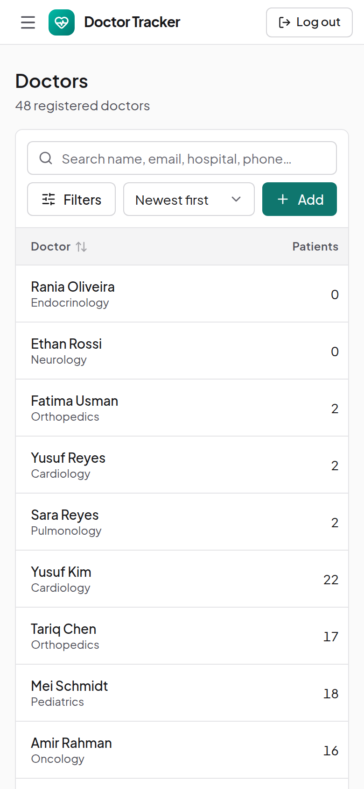 |

| Doctor's page | Patients | Patient details (tap a row) |
|---|---|---|
| 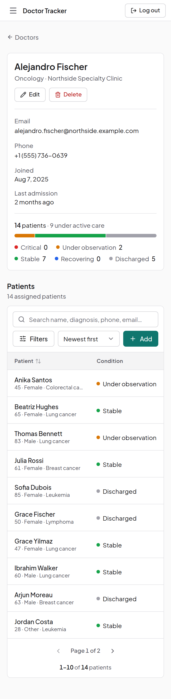 | 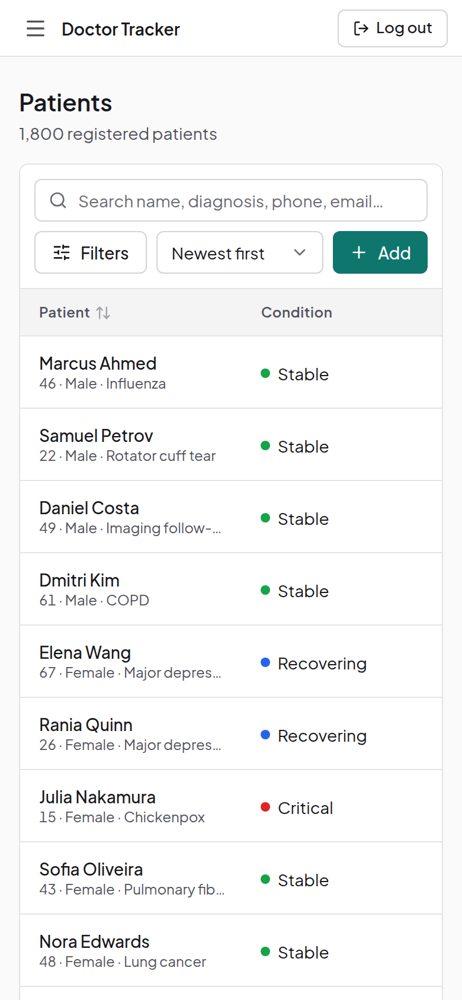 | 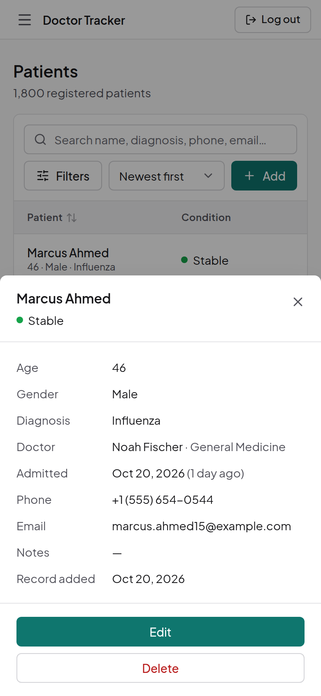 |

| Landing page | Sign in |
|---|---|
| 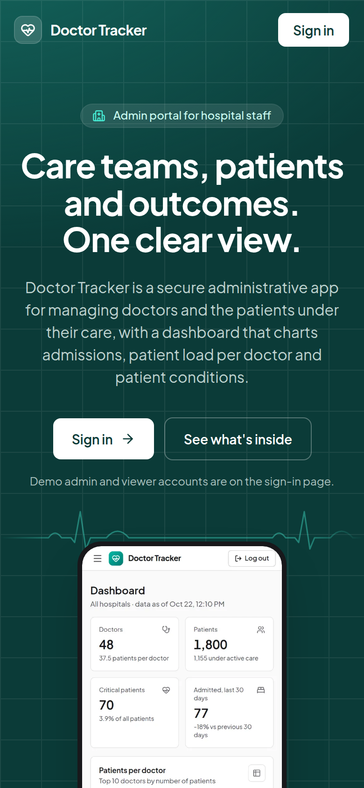 | 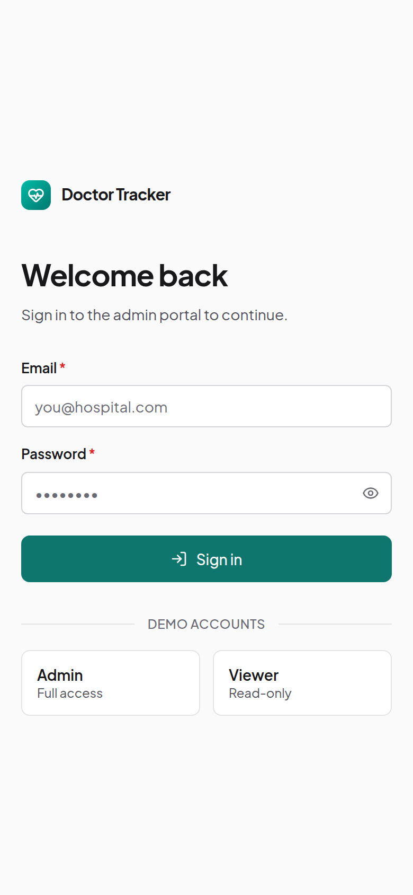 |

---

## Testing

```bash
cd backend
# Uses a separate database (doctor_tracker_test) that is dropped after the run.
MONGODB_URI_TEST=mongodb://localhost:27017/doctor_tracker_test npm test
```

33 tests (Vitest and Supertest against a real MongoDB) cover:

- **Auth:** a generic error for bad credentials; the httpOnly cookie; 401 with no cookie or a tampered one; logout.
- **Authorization:** a viewer gets 403 on every write route (all 8 of them).
- **Validation:** field-level details, unknown fields rejected, future admission dates rejected.
- **Behavior:** 409 on a duplicate email; prefix search, filters, sorting and pagination meta; search keywords rebuilt on update; the nested doctor → patient routes, including refusing to delete another doctor's patient or a doctor who still has patients; dashboard numbers reflecting writes immediately.
- **Unit:** the search tokenizer, including the two-character minimum.

The frontend is checked with `tsc` and ESLint (`next/core-web-vitals` plus TypeScript rules). End-to-end behavior was verified with Playwright scripts at 1440 px and 390 px. They are kept outside the repo, so there are no committed frontend tests. The scripts covered:

- Login and logout, with the `next` redirect.
- Protected routes while signed out, and the API's 401.
- Viewer accounts: no write controls in the UI, and 403 from the API.
- Search, filters and pagination on both lists.
- Adding, editing and deleting a patient under a doctor.
- Dashboard numbers against direct database counts.

---

## Scalability Considerations

- **Multiple API instances.** Sessions are self-contained JWTs and the user is re-checked per request with an indexed `_id` lookup, so the API scales horizontally. Two pieces of state are per process today: the 60-second dashboard cache and the login rate limiter. With several instances (Vercel runs several under load), a write clears only the cache of the instance that handled it, so another instance can show a dashboard up to 60 seconds old, and the login limit is counted per instance. Both would move to a shared store such as Redis, keeping the same keys.
- **Pagination.** Offset pagination fits page-number UI and is index-backed, but deep pages still walk `skip` index keys. For infinite scroll or exports past roughly 100k rows, the API would switch to keyset (cursor) pagination on the `{sortKey, _id}` indexes it already has.
- **Search** can move to Atlas Search `autocomplete` without changing callers (see [Decision 2](#2-index-backed-prefix-search-with-keyword-arrays-instead-of-regex-scans-text-or-atlas-search)).
- **Dashboard aggregations.** "Patients per doctor" and "patients by condition" never read documents, but they still walk one index key per patient (1,800 today). At millions of patients they would read from pre-aggregated counters updated on write (or a `daily_stats` collection filled by a scheduled job), keeping the endpoint constant-time.
- **Index rollout.** Mongoose builds missing indexes on startup, which is convenient in development. In production, index changes should roll out as an explicit step: `npm run db:sync-indexes:prod` builds new indexes and drops obsolete ones.
- **Session revocation.** Logout clears the cookie but doesn't revoke the token. Because the user is reloaded on every request, deactivating an account or changing a role takes effect immediately, but a copied token stays valid until it expires (8 hours). A `tokenVersion` on the user, checked during that same lookup, would allow "log out everywhere".
- **Asymmetric tokens.** Moving from HS256 to EdDSA or RS256 would let the web tier verify sessions with a public key only, so it could never mint them.

---

## Project Structure

```text
.
├── docker-compose.yml            # mongo (+ api and web under the "app" profile)
├── .env.example                  # compose variables
├── docs/screenshots/             # README images
├── backend/                      # Express REST API (TypeScript, ESM)
│   ├── server.js                 # Vercel entry: imports the compiled app from dist/
│   ├── vercel.json
│   ├── src/
│   │   ├── index.ts              # local/Docker bootstrap, graceful shutdown
│   │   ├── app.ts                # Express app (middleware, routers), also used by tests
│   │   ├── config/               # env (Zod-validated), db connection, domain constants
│   │   ├── lib/                  # ApiError, validation helpers, search, pagination, TTL cache
│   │   ├── middleware/           # authenticate, requireAdminForWrites, error and 404 handlers
│   │   ├── modules/              # one folder per feature: model · schema · service · controller · routes
│   │   │   └── auth/  users/  doctors/  patients/  stats/
│   │   └── scripts/              # seed, explain-queries, sync-indexes
│   ├── tests/                    # Vitest + Supertest
│   └── Dockerfile
└── frontend/                     # Next.js 16 App Router (TypeScript)
    ├── src/
    │   ├── proxy.ts              # route protection (JWT verification)
    │   ├── app/                  # routes only: / (landing), login, (app)/dashboard, doctors, doctors/[id], patients
    │   ├── assets/               # product screenshots shown on the landing page
    │   ├── features/             # domain code: data hooks and components per feature
    │   │   └── auth/  dashboard/  doctors/  patients/
    │   ├── components/
    │   │   ├── ui/               # button, input, select, dialog, table, pagination, states, …
    │   │   ├── filters/          # list toolbar, filter panel, chips, date range
    │   │   ├── charts/           # chart card (loading, empty, error, table view), tooltip
    │   │   └── layout/           # logo, brand backdrop, sidebar, top bar, nav, page skeletons
    │   ├── hooks/                # URL state, debounce, hydration
    │   └── lib/                  # API client, query client and keys, constants, utils
    └── Dockerfile
```

Routes in `app/` stay thin: they compose feature components inside Suspense boundaries. Each feature folder owns its data hooks (`api.ts`), types and UI. Shared components carry no data fetching, so any feature can reuse them. Design tokens (colors, borders, chart and status colors) are CSS custom properties in `globals.css`.
