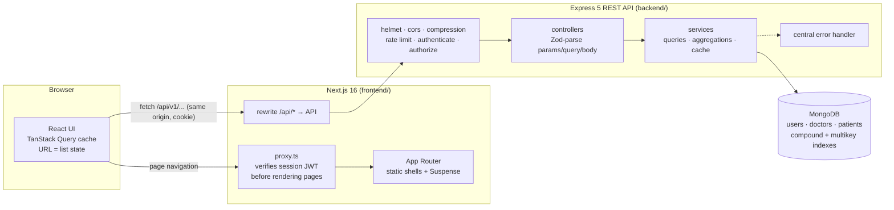
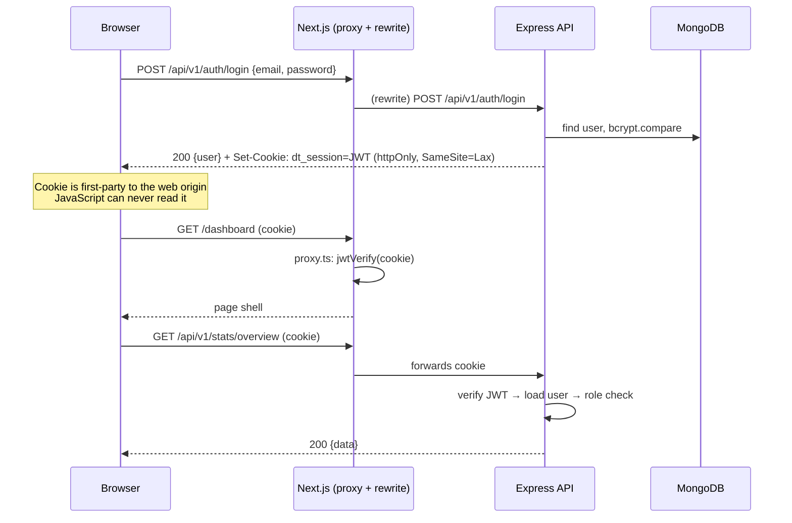
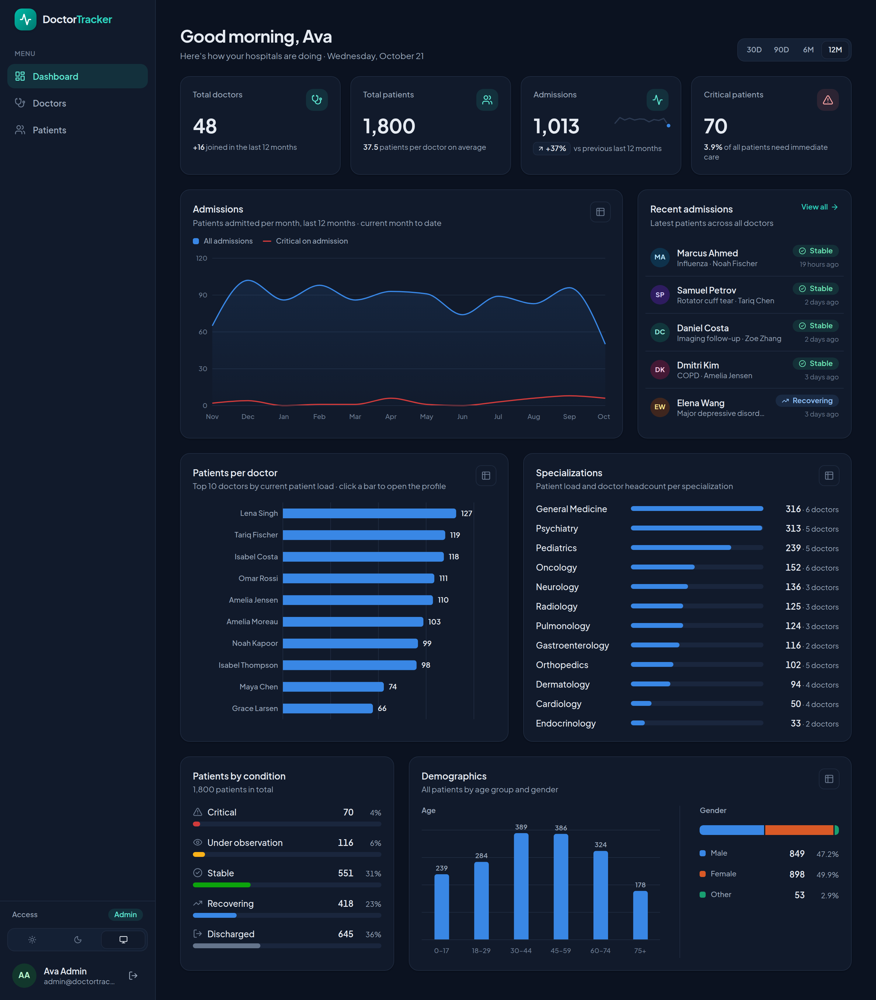
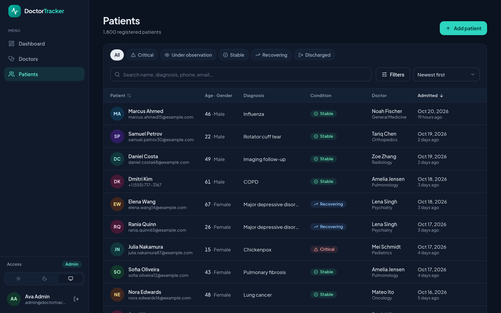
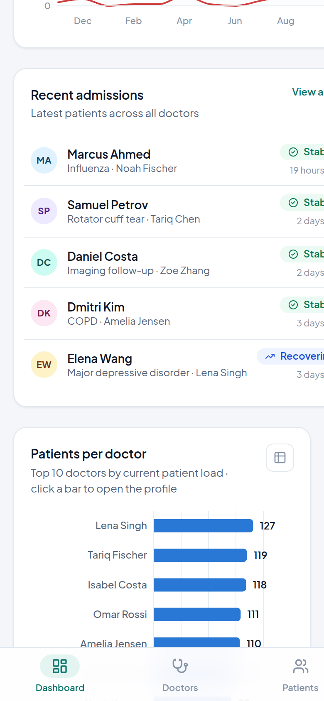
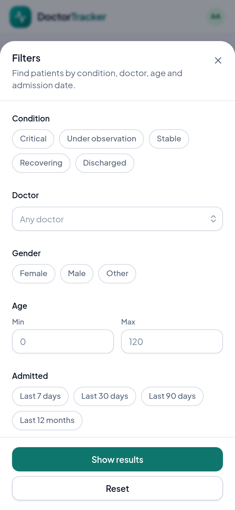
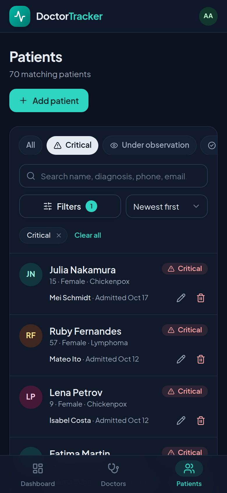
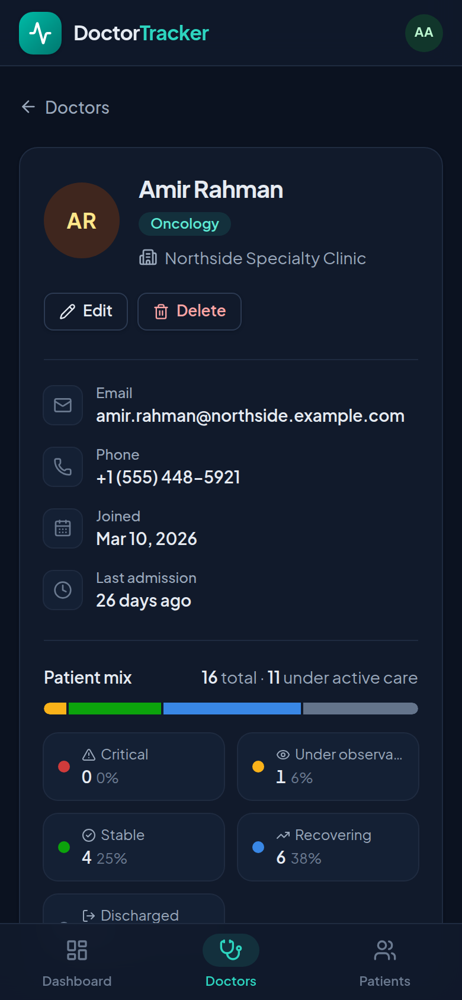

# Doctor Tracker

**Next.js 16 · React 19 · TanStack Query 5 · Tailwind CSS 4 · Recharts 3 · Express 5 · Mongoose 9 · MongoDB 7 · Zod 4 · TypeScript**

## Description

Doctor Tracker is a secure admin portal for hospital staff who need one reliable place to manage **doctors and the patients under their care**. Admins sign in to a role-protected workspace where they can register doctors, assign and update patients, and find anyone in seconds with search, filters, sorting and pagination that stay fast as the data grows. A live analytics dashboard turns the same data into insight: admissions trends, patient load per doctor, condition mix, specialization workload and demographics. The app is built as a **Next.js frontend** talking to a **standalone Express REST API** over MongoDB, with httpOnly-cookie sessions, role-based authorization, index-backed queries, and a responsive UI with light and dark themes.

> **Demo accounts** (created by the seed script)
>
> | Role | Email | Password | Can do |
> |---|---|---|---|
> | Admin | `admin@doctortracker.dev` | `Admin@12345` | Everything |
> | Viewer | `viewer@doctortracker.dev` | `Viewer@12345` | Read-only (all write buttons hidden; API returns 403) |
>
> The login page also has one-click "Demo accounts" buttons.

### Contents

- [Features](#features)
- [Setup Guide](#setup-guide)
- [System Architecture](#system-architecture)
- [Technical Decisions](#technical-decisions)
- [Performance & Optimization](#performance--optimization)
- [Visual Evidence](#visual-evidence)
- [Testing](#testing)
- [Scalability Considerations](#scalability-considerations)
- [Project Structure](#project-structure)

---

## Features

| Requirement | Implementation |
|---|---|
| **Authentication** | Email/password login (bcrypt, cost 12). Session is a signed JWT in an **httpOnly, SameSite=Lax** cookie (Secure in production), 8h expiry. Login is rate-limited (10 failed attempts / 15 min / IP), and unknown emails take the same time as wrong passwords, so timing doesn't reveal which accounts exist. |
| **Route protection** | `src/proxy.ts` (Next 16's replacement for middleware) verifies the JWT before any page renders and redirects to `/login?next=…`. Every API route below `/auth` requires a valid session, re-checked against the database on each request. |
| **Authorization** | Roles `admin` / `viewer`. Writes require `admin` on the API (`authorize('admin')`); the UI hides write actions for viewers. |
| **Doctor management** | Create / edit / delete doctors (name, specialization, hospital, phone, email). List with **prefix search** (name, email, hospital, specialization, phone), **filters** (specialization multi-select, hospital, joined-date range with presets), **sorting** (newest, oldest, name A–Z/Z–A, plus sortable column headers) and **pagination** (10/20/50 per page). |
| **A doctor's patients** | Doctor profile page with contact details, patient mix (by condition), and the doctor's own paginated, searchable, filterable patient list. **Add patients under the doctor** (`POST /doctors/:id/patients`) and **remove patients from their list** (`DELETE /doctors/:id/patients/:patientId`, which only succeeds if the patient really belongs to that doctor). A doctor who still has patients can't be deleted (409, explained in the UI up front). |
| **Patient management** | Dedicated patients page: list, create, **edit** (including reassigning the doctor via a searchable combobox), delete. **Search** (name, diagnosis, phone, email), **filters**: condition (quick pills + multi-select), doctor, gender, age range, admission-date range; **sorting** and **pagination**. |
| **Dashboard** | KPI tiles (doctors, patients, admissions with % change vs the previous period and a sparkline, critical patients), admissions trend (area + critical line), patients per doctor (top 10, clickable bars), patients by condition, specialization workload, age and gender demographics, recent admissions. Range switch: 30D / 90D / 6M / 12M. Plotted charts have a table view for accessibility; bar lists show their values as text. |
| **UI/UX** | Responsive (sidebar on desktop, top bar + bottom tab bar on mobile, table ↔ card lists), light/dark/system themes with no flash, skeleton loading, background-refresh progress bar, empty and error states with retry, toasts, inline field errors (including server-side ones like "email already in use"), keyboard-accessible dialogs, comboboxes and sortable headers. |
| **Validation & errors** | Zod on both sides. The API rejects unknown fields (no mass assignment), invalid ids (400), duplicates (409) and malformed JSON, all in one consistent error format. |

---

## Setup Guide

### Prerequisites

- **Node.js 20.19+** (developed on Node 22–26) and npm 10+
- **MongoDB 6+**. The easiest route is Docker (`docker compose up -d mongo` uses `mongo:7.0`). A MongoDB Atlas URI works too.

> On Linux kernels ≥ 6.19, recent native `mongod` 8.0 builds refuse to start ([SERVER-121912](https://jira.mongodb.org/browse/SERVER-121912)). The Docker image (MongoDB 7.0) is not affected.

### Option A: run locally (recommended for review)

```bash
# 1. Database
cp .env.example .env              # only used by docker compose (ports, shared secret)
docker compose up -d mongo        # MongoDB on localhost:27017 (change MONGO_PORT in .env if taken)

# 2. API  →  http://localhost:4000
cd backend
cp .env.example .env
#   Set JWT_SECRET to a long random string:  openssl rand -base64 48
#   (and MONGODB_URI if you changed MONGO_PORT)
npm install
npm run seed                      # 2 demo users, 48 doctors, 1,800 patients (deterministic)
npm run dev

# 3. Web app  →  http://localhost:3000
cd ../frontend
cp .env.example .env.local
#   Set JWT_SECRET to the SAME value as backend/.env
npm install
npm run dev
```

Open http://localhost:3000 and sign in with a demo account.

### Option B: everything in Docker

```bash
cp .env.example .env              # set JWT_SECRET (any 32+ char random string)
docker compose --profile app up -d --build
docker compose --profile app run --rm api node dist/scripts/seed.js --force   # demo data
```

The web app is on `http://localhost:${WEB_PORT}` (default 3000) and the API on `http://localhost:${API_PORT}` (default 4000).
To use MongoDB Atlas instead of the bundled container, set `MONGODB_URI` (including the `/doctor_tracker` database name) in the root `.env`.

### Environment variables

Each service ships an `.env.example`: [`backend/.env.example`](backend/.env.example), [`frontend/.env.example`](frontend/.env.example), and the root [`.env.example`](.env.example) for Docker Compose.

| Variable | Where | Purpose |
|---|---|---|
| `MONGODB_URI` | backend (optional in root `.env` for Docker) | MongoDB connection string, local or Atlas (`mongodb+srv://…/doctor_tracker`) |
| `JWT_SECRET` | backend **and** frontend | Signs (API) and verifies (web proxy) session tokens. Must be identical, ≥ 32 chars. Server-side only, never sent to the browser. |
| `JWT_EXPIRES_IN` | backend | Session lifetime (default `8h`) |
| `COOKIE_NAME` / `SESSION_COOKIE_NAME` | backend / frontend | Session cookie name (default `dt_session`) |
| `COOKIE_SECURE` | backend | Defaults to `true` in production; set `false` only for plain-HTTP setups |
| `CORS_ORIGINS` | backend | Origins allowed to call the API directly (not needed when going through the web app) |
| `TRUST_PROXY` | backend | Express `trust proxy` (correct client IPs behind the Next.js proxy, used for rate limiting) |
| `STATS_CACHE_TTL_SECONDS` | backend | Dashboard aggregation cache TTL (default 60, `0` disables) |
| `API_URL` | frontend | Where `/api/*` is proxied to (default `http://localhost:4000`). Build-time for Docker images. |

### Useful scripts

| Command | Where | What it does |
|---|---|---|
| `npm run dev` | backend / frontend | Dev servers (tsx watch / Next.js Turbopack) |
| `npm run build && npm start` | backend / frontend | Production build + start |
| `npm run seed` | backend | Reset the database to the demo dataset. Refuses to run in production without `--force`. |
| `npm run explain` | backend | Prints MongoDB query plans for the API's hot queries (see [Performance](#performance--optimization)) |
| `npm test` | backend | Vitest + Supertest integration tests (needs MongoDB, see [Testing](#testing)) |
| `npm run typecheck` | backend, frontend | TypeScript checks |
| `npm run lint` | frontend | ESLint |

---

## System Architecture



**Two independent services that talk REST.** The browser only ever talks to the Next.js origin. Next.js serves pages and transparently proxies `/api/*` to the Express API. The API owns all data access and business rules; the web app never touches MongoDB.

**How a request flows**

1. **Page navigation** (`/patients?condition=critical`): `proxy.ts` reads the `dt_session` cookie and verifies the JWT signature, issuer, audience and expiry with `jose`. With no valid session it redirects to `/login?next=/patients?condition=critical`. Otherwise Next serves the page's prerendered static shell (Cache Components / Partial Prerendering), and the client components stream in.
2. **Data** (`GET /api/v1/patients?condition=critical&page=1`): TanStack Query calls the same-origin URL. The rewrite forwards it with the cookie to Express, which checks the session (`authenticate` also reloads the user, so a deactivated or demoted account loses access immediately), validates the query with Zod, runs an index-backed query and returns `{ data, meta }`.
3. **Mutations** (`POST /api/v1/doctors/:id/patients`): `authorize('admin')`, then Zod body validation (strict: unknown keys rejected), then the service. On success the dashboard cache is invalidated server-side, and the client invalidates exactly the query keys the write affects (lists, doctor counts, stats).
4. **Errors** surface in one shape, `{ error: { code, message, details[] } }`. The frontend maps `details` onto form fields, shows toasts for everything else, and treats a `401` on any data call as an expired session (full redirect to login with an "expired" notice).

### Authentication flow



### API reference (`/api/v1`)

| Method | Path | Auth | Description |
|---|---|---|---|
| `POST` | `/auth/login` | public, rate-limited | Sign in, sets the session cookie |
| `POST` | `/auth/logout` | public | Clears the session cookie |
| `GET` | `/auth/me` | session | Current user |
| `GET` | `/doctors` | session | `?search&specialization=a,b&hospital&from&to&sort&page&limit` |
| `POST` | `/doctors` | admin | Create doctor |
| `GET` | `/doctors/facets` | session | Specializations + distinct hospitals (filter options) |
| `GET` | `/doctors/options` | session | Lightweight searchable list for pickers (`?search&limit`) |
| `GET` | `/doctors/:id` | session | Doctor + patient counts by condition + last admission |
| `PATCH` | `/doctors/:id` | admin | Partial update |
| `DELETE` | `/doctors/:id` | admin | 409 if the doctor still has patients |
| `GET` | `/doctors/:id/patients` | session | That doctor's patients (same query params as `/patients`) |
| `POST` | `/doctors/:id/patients` | admin | Add a patient under the doctor |
| `DELETE` | `/doctors/:id/patients/:patientId` | admin | Remove a patient from the doctor's list (404 if not theirs) |
| `GET` | `/patients` | session | `?search&condition=a,b&doctor&gender&minAge&maxAge&from&to&sort&page&limit` |
| `POST` | `/patients` | admin | Create patient (with `doctor` id) |
| `GET` / `PATCH` / `DELETE` | `/patients/:id` | session / admin / admin | Read / update (incl. reassign) / delete |
| `GET` | `/stats/overview` | session | Whole dashboard in one call (`?range=30d|90d|6m|12m`) |
| `GET` | `/health` | public | Liveness + DB connectivity |

List responses: `{ data: T[], meta: { page, limit, total, totalPages, hasNextPage, hasPrevPage } }`.

### Data model

| Collection | Fields | Indexes |
|---|---|---|
| `users` | name, email, passwordHash (`select: false`), role, active | `{email}` unique |
| `doctors` | name, specialization (enum), hospital, phone, email, searchKeywords (derived, hidden), timestamps | `{email}` unique · `{createdAt,_id}` · `{specialization,createdAt,_id}` · `{hospital,createdAt,_id}` · `{name,_id}` · `{searchKeywords}` multikey |
| `patients` | name, age, gender, phone, email?, diagnosis, condition (enum), admissionDate, notes?, doctor (ref), searchKeywords, timestamps | `{doctor,admissionDate,_id}` · `{admissionDate,_id}` · `{condition,admissionDate,_id}` · `{name,_id}` · `{searchKeywords}` multikey |

---

## Technical Decisions

### 1. Server state in TanStack Query, list state in the URL, instead of Redux or a Context store

**The problem.** This app has three kinds of state. Treating them as one is what usually makes admin apps sluggish and buggy:

| Kind | Examples | Where it lives |
|---|---|---|
| Server cache | doctors, patients, dashboard stats, the session | **TanStack Query** |
| Shareable view state | page, page size, search, filters, sort, dashboard range | **The URL query string** |
| Ephemeral UI state | which dialog is open, a filter draft, a combobox's input | **Local `useState`** |

**Why not Redux (or a Context store)?** Almost all of the "global state" here is a copy of server data. In Redux we would hand-write loading/error flags, request de-duplication, caching per filter combination, stale-while-revalidate, cancellation, retries and invalidation after writes: hundreds of lines that TanStack Query does correctly by default. And putting filters in a store would make them *worse*: lost on reload, not shareable, and the back button wouldn't work. A Context-based store also re-renders every consumer on every change, which is exactly the "unnecessary re-renders" problem we were asked to avoid.

**How it works here**

- **Hierarchical query keys** ([`lib/query-keys.ts`](frontend/src/lib/query-keys.ts)), e.g. `['patients','list',{…params, scope}]`. Each mutation invalidates precisely what it affects. Adding a patient invalidates patient lists, doctor lists (patient counts), doctor profiles (patient mix) and stats, but not the doctor facets or the session. Editing a doctor patches the cached profile immediately with `setQueryData`.
- **Smooth paging and filtering.** `placeholderData: keepPreviousData` keeps the current rows on screen (dimmed, with a thin progress bar) while the next page loads, so there's no skeleton flash or layout jump. The **next page is prefetched** as soon as the current one arrives, and **hovering a doctor row prefetches the profile**, so most clicks feel instant.
- **URL as the source of truth** ([`hooks/use-url-state.ts`](frontend/src/hooks/use-url-state.ts)). List views derive typed params from `useSearchParams()` (validated against allow-lists, so a hand-edited URL can't send garbage), and updates use `window.history.replaceState`. Next.js syncs that into `useSearchParams` **without a server round trip** and without a history entry per keystroke. Every view is linkable: the dashboard's "Critical patients" tile and condition bars deep-link to `/patients?condition=critical`, and specializations link to `/doctors?specialization=…`.
- **Search** keeps keystrokes in local state and only writes the URL after 300 ms of inactivity, so one request per pause, not per character. Filter **drafts** live in the filter sheet and are applied in one go ("Show results").
- **Re-render discipline.** Memoized table rows and cards with stable callbacks (`useCallback`), `select` to subscribe to just the slice a component needs, charts wrapped in `memo`, and media queries read through `useSyncExternalStore` so only one of the table and card variants is ever rendered.
- **Retries that make sense.** Queries retry network and 5xx failures but never 4xx (a validation error won't fix itself). A `401` anywhere triggers a single full redirect to login, which also discards every cached query from the dead session.

**Trade-offs.** URL params must be parsed and validated on read (a few small helpers). There is no offline persistence. If cross-page client-only state ever appears (e.g. a multi-step wizard), a tiny store like Zustand would be the next step. Redux would still be overkill.

### 2. Index-backed prefix search with keyword arrays, instead of `$regex` scans, `$text`, or Atlas Search

**The problem.** Admins type fragments: `"joh smi"`, `"riverside"`, `"555-01"`, `"diab"`. Search must match **partial words across several fields**, combine with filters, sort and paginate, and stay fast as collections grow.

| Option | Partial words | Uses an index | Verdict |
|---|---|---|---|
| `{ name: /joh/i }` (unanchored, case-insensitive `$regex`) | ✅ | ❌ full collection scan, O(n) | Fine for 1k docs, collapses at 1M |
| `$text` index | ❌ whole words/stems only (`joh` ≠ `john`) | ✅ | Wrong UX for type-ahead; one text index per collection; awkward to combine with custom sorts |
| Atlas Search (`autocomplete`) | ✅ (+ fuzzy) | ✅ (Lucene) | Best at scale, but requires Atlas and isn't available on self-hosted MongoDB 7 |
| **Keyword array + anchored prefix regex** | ✅ prefixes | ✅ multikey index bounds | **Chosen** |

**How it works** ([`lib/search.ts`](backend/src/lib/search.ts)):

1. A `pre('validate')` hook stores a hidden `searchKeywords` array on every doctor and patient: lower-cased, accent-stripped tokens from the searchable fields, plus the full email and the digits-only phone number. *José Álvarez · Cardiology* becomes `["jose","alvarez","cardiology", …]`.
2. A query like `"Jo smi"` becomes `{ searchKeywords: { $all: [/^jo/, /^smi/] } }`. Anchored, case-sensitive regexes on an already-lowercased field compile to **tight index bounds** (`["jo","jp")`), so MongoDB walks a few index keys instead of scanning documents. Input is regex-escaped and capped (5 terms, 40 chars each).
3. Because it's a plain filter, it composes with every other filter, sort and page (no special code path).

From `npm run explain` on the seeded data:

```text
Patients: multi-word prefix search "marcus ahm"
  plan:      PROJECTION_SIMPLE <- SORT <- FETCH <- IXSCAN(searchKeywords_1)
  examined:  49 keys, 28 docs → 3 returned in 1ms
Doctors: search "card" sorted by name
  plan:      PROJECTION_SIMPLE <- SORT <- FETCH <- IXSCAN(searchKeywords_1)
  examined:  5 keys, 4 docs → 4 returned in 0ms
```

The planner picks the multikey index to narrow the match first, then sorts the handful of hits in memory: cheaper than walking a sort index across the whole collection.

**The rest of the query strategy follows the same principle.** Every query is answered from an index (all plans are in [Performance](#performance--optimization)).

**Trade-offs.** Slight write amplification (a keyword array and its index per document). Prefix-only matching (`ohn` won't find `John`), with no typo tolerance or relevance ranking: results follow the chosen sort. These are the right defaults for an admin directory. At very large scale the drop-in upgrade is Atlas Search's `autocomplete` operator, which would replace only `buildSearchFilter`.

### Other decisions in brief

- **Same-origin API via Next.js rewrites (a thin BFF).** The browser never calls the API's origin, so the httpOnly session cookie is first-party, CORS never comes into play, and the token is never exposed to JavaScript (unlike `localStorage` tokens, which any XSS can steal). `proxy.ts` verifies the same JWT, so protected pages never flash for signed-out users. The API still enforces auth on every request, so the proxy is a UX layer, not the only line of defense.
- **One aggregated dashboard endpoint.** `/stats/overview` runs four aggregations in parallel. Whole-population breakdowns (condition, gender, age buckets, top doctors, specialization rollup) come from a single `$facet` pass, the trend is range-bounded by the `admissionDate` index, and `$lookup` joins happen *after* `$limit` (10 lookups, not 1,800). Results sit in a 60 s in-process cache that shares in-flight promises and is cleared on every write, so the dashboard is never stale after a change made through the API.
- **Accurate, cheap patient counts.** Instead of a denormalized `patientCount` that can drift without transactions, the doctors list counts patients only for the doctors on the current page: one covered `$group` over the `{doctor,…}` index.
- **Accessible primitives without a UI library.** The native `<dialog>` element (browser-managed focus trap, inert background, Escape), the native Popover API for the combobox list (never clipped by a dialog's scroll area), WAI-ARIA combobox and radio patterns, and visible focus rings. Status colors always come with an icon and a label, and plotted charts have a table view.
- **Data-viz palette validated for color-blind safety.** The categorical colors were run through a CVD validator in both themes. Red/green status colors are never relied on side by side without labels, two measures never share a dual axis, and text never wears a data color.
- **Next.js 16 Cache Components.** Static app shells are prerendered. Request-dependent pieces (`useSearchParams`, `usePathname` on dynamic routes) sit inside Suspense boundaries, and session-derived UI only renders after hydration, to avoid server/client mismatches.

---

## Performance & Optimization

**Database.** Output of `npm run explain` (48 doctors / 1,800 patients). Every hot path is an index scan, with no collection scans and no in-memory sorts outside search:

```text
Doctors: default list (newest first, page 3)
  plan:      LIMIT <- PROJECTION_SIMPLE <- FETCH <- SKIP <- IXSCAN(createdAt_-1__id_-1)
  examined:  30 keys, 10 docs → 10 returned in 0ms
Doctors: specialization filter + joined date range
  plan:      LIMIT <- PROJECTION_SIMPLE <- FETCH <- IXSCAN(specialization_1_createdAt_-1__id_-1)
Patients: one doctor's patients (newest first)
  plan:      LIMIT <- PROJECTION_SIMPLE <- FETCH <- IXSCAN(doctor_1_admissionDate_-1__id_-1)
  examined:  10 keys, 10 docs → 10 returned in 0ms
Patients: critical, admitted in last 90 days
  plan:      LIMIT <- PROJECTION_SIMPLE <- FETCH <- IXSCAN(condition_1_admissionDate_-1__id_-1)
Patients: filtered count (what countDocuments runs)
  plan:      COUNT_SCAN(condition_1_admissionDate_-1__id_-1)
  examined:  71 keys, 0 docs → 70 returned in 0ms
Patients: patient counts for one page of doctors
  plan:      PROJECTION_COVERED <- IXSCAN(doctor_1_admissionDate_-1__id_-1)
  examined:  93 keys, 0 docs → 84 returned in 0ms
```

- Compound indexes are shaped **filter → sort → `_id`**. Every list sorts with an `_id` tie-breaker for stable pagination, so the index provides the full sort order.
- `find` + `countDocuments` run **in parallel**. Unfiltered totals use `estimatedDocumentCount()` (collection metadata, no scan).
- `.lean()` everywhere on reads, explicit projections (`searchKeywords` and `passwordHash` are `select: false`), and `populate` only for the doctors on the current page (one `$in` query).
- Dashboard: about 20 ms cold and about 3 ms cached on the seeded dataset.

**API.** gzip compression, 100 kb body limit, helmet security headers, graceful shutdown (drains connections, closes the Mongo pool).

**Frontend.** Static shells prerendered at build time (`○ /dashboard`, `○ /doctors`, `○ /patients`, `◐ /doctors/[id]`). Client cache with prefetching (next page, doctor profile on hover). Debounced search, memoized rows and charts, `optimizePackageImports` for icons/charts/date-fns (Next.js defaults), `next/font` self-hosted fonts, no layout shift between loading and loaded states.

---

## Visual Evidence

All screenshots come from the production Docker build with the seeded demo data.

### Desktop

**Dashboard**


**Doctors: search, filters, sorting, pagination**


**Doctor profile with the doctor's patients**


| Patients filter sheet | Add patient (doctor combobox) |
|---|---|
|  |  |

| Dark mode dashboard | Dark mode patients |
|---|---|
|  |  |

**Sign in**


### Mobile

| Dashboard | Charts | Doctors | Filters |
|---|---|---|---|
|  |  |  |  |

| Critical patients (dark) | Doctor profile (dark) |
|---|---|
|  |  |

---

## Testing

```bash
cd backend
# Uses a separate database (doctor_tracker_test) that is dropped after the run.
MONGODB_URI_TEST=mongodb://localhost:27017/doctor_tracker_test npm test
```

31 tests (Vitest + Supertest against a real MongoDB) cover the important cases:

- Auth: generic error on bad credentials; httpOnly cookie; 401 without or with a tampered cookie; logout.
- Authorization: viewers get 403 on writes.
- Validation: field-level details, unknown fields rejected, future admission dates rejected.
- Behavior: 409 on duplicate email; prefix search, filters, sorting and pagination meta; search keywords rebuilt on update; nested doctor→patient routes (including refusing to delete another doctor's patient or a doctor with patients); dashboard stats reflecting writes immediately.
- Unit: the search tokenizer.

The frontend is checked with `tsc` and ESLint (`next/core-web-vitals` + TypeScript rules, including the React Compiler-aware hooks rules). The full UI was exercised end to end with Playwright during development: login with redirect target, CRUD of doctors and patients, 409 mapped to a field, the combobox, URL-state restore, and session expiry.

---

## Scalability Considerations

- **Stateless API.** Sessions are self-contained JWTs and the user is re-validated per request (indexed `_id` lookup), so the API scales horizontally behind a load balancer. With more than one instance, the dashboard cache moves from in-process to Redis using the same keys, and the rate limiter gets a Redis store.
- **Pagination.** Offset pagination fits page-number UX and is index-backed. Deep pages still cost `skip` keys, so for infinite scroll or exports past roughly 100k rows the API would switch to keyset (cursor) pagination on the same `{sortKey,_id}` indexes it already has.
- **Search** upgrades to Atlas Search `autocomplete` without touching callers (see [Decision 2](#2-index-backed-prefix-search-with-keyword-arrays-instead-of-regex-scans-text-or-atlas-search)).
- **Dashboard aggregations.** At millions of patients, the whole-population `$facet` would move to a pre-aggregated `daily_stats` collection updated on write (or by a scheduled job), keeping the endpoint constant-time.
- **Indexes in production.** Mongoose builds declared indexes on startup, which is convenient for development. For large production collections, index builds should run as an explicit migration step (the seed script uses `syncIndexes()`).
- **Asymmetric tokens.** Moving from HS256 to EdDSA/RS256 would let the web tier verify sessions with a public key only, so it could never mint tokens.
- **Deployment.** The web app deploys to Vercel or any Node host (`output: 'standalone'` Docker image included). The API deploys to any container platform (Render, Fly, Railway, ECS). The database is MongoDB Atlas. Set `API_URL` and `JWT_SECRET` on the web app, and `MONGODB_URI`, `JWT_SECRET` and `COOKIE_SECURE=true` on the API.

---

## Project Structure

```text
.
├── docker-compose.yml            # mongo (+ api, web under the "app" profile)
├── .env.example                  # compose variables
├── docs/screenshots/             # README images
├── backend/                      # Express REST API (TypeScript, ESM)
│   ├── src/
│   │   ├── index.ts              # bootstrap, graceful shutdown
│   │   ├── app.ts                # express app (middleware, routers) — imported by tests
│   │   ├── config/               # env (Zod-validated), db, domain constants
│   │   ├── lib/                  # ApiError, validation helpers, search, pagination, TTL cache
│   │   ├── middleware/           # authenticate / authorize, error + 404 handlers
│   │   ├── modules/              # feature modules: model · schema · service · controller · routes
│   │   │   ├── auth/  users/  doctors/  patients/  stats/
│   │   └── scripts/              # seed (deterministic demo data), explain-queries
│   ├── tests/                    # vitest + supertest
│   └── Dockerfile
└── frontend/                     # Next.js 16 App Router (TypeScript)
    ├── src/
    │   ├── proxy.ts              # route protection (JWT verification)
    │   ├── app/                  # routes only: (app)/dashboard, doctors, doctors/[id], patients, login
    │   ├── features/             # domain code: api hooks + components per feature
    │   │   ├── auth/  dashboard/  doctors/  patients/
    │   ├── components/
    │   │   ├── ui/               # design system: button, input, dialog, table, pagination, …
    │   │   ├── filters/          # filter sheet, chips, toggle group, date range
    │   │   ├── charts/           # chart card, tooltip, data table
    │   │   └── layout/           # sidebar, mobile nav, theme switcher
    │   ├── hooks/                # url state, media query, theme, debounce, hydration
    │   └── lib/                  # api client, query client + keys, constants, utils
    └── Dockerfile
```

Routes in `app/` stay thin and only compose feature components inside Suspense boundaries. Each feature folder owns its data hooks (`api.ts`), types and UI. Shared presentational components carry no data-fetching logic, so they are reusable across features. The design system lives in CSS custom properties (`globals.css`), so light and dark mode is a single token swap.
